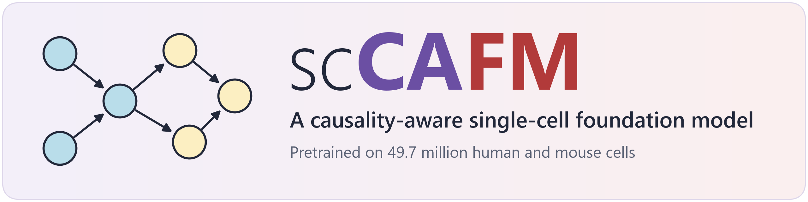
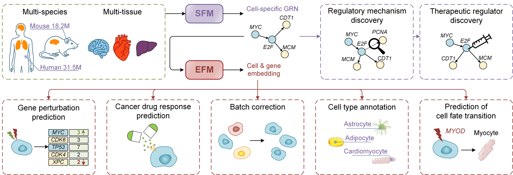
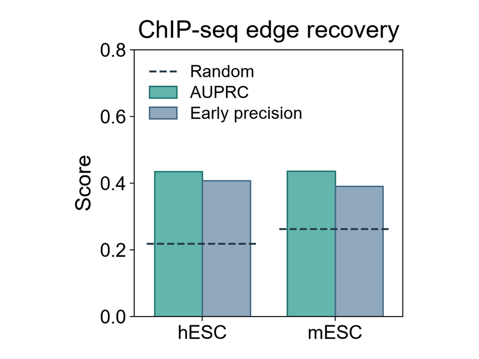
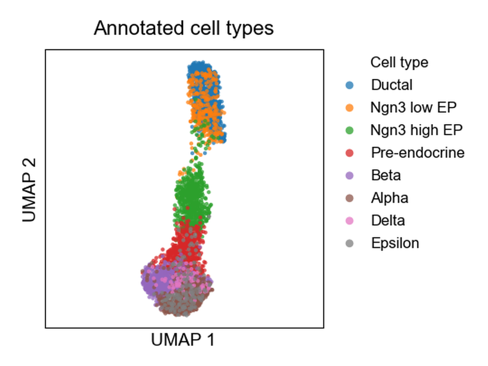
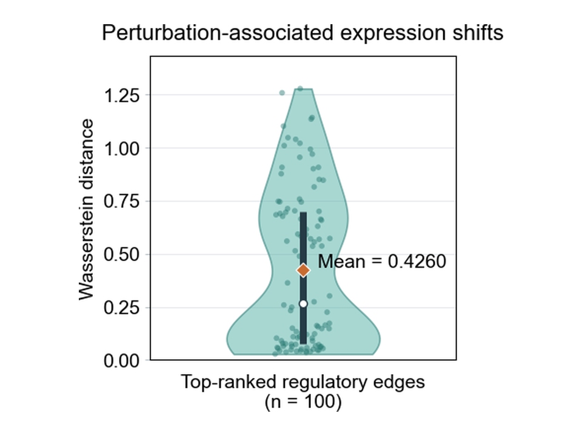
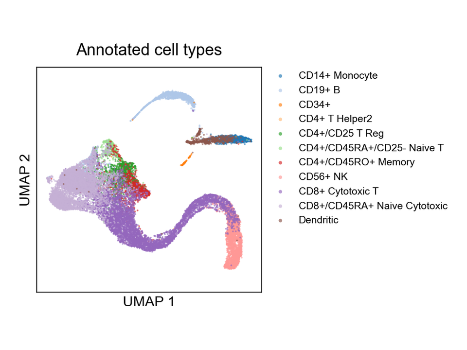
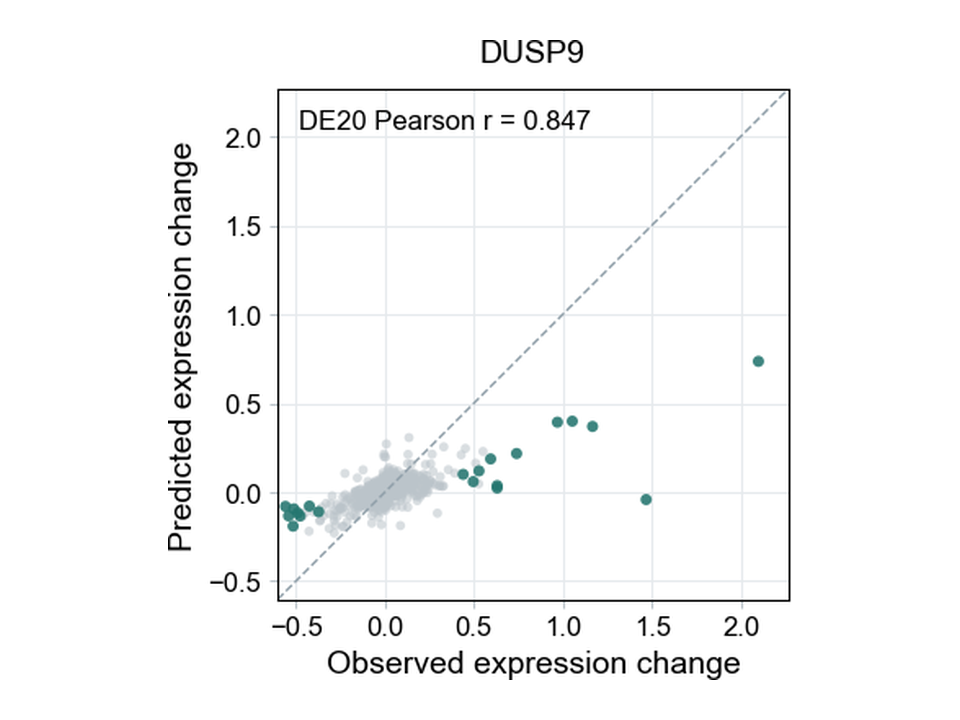
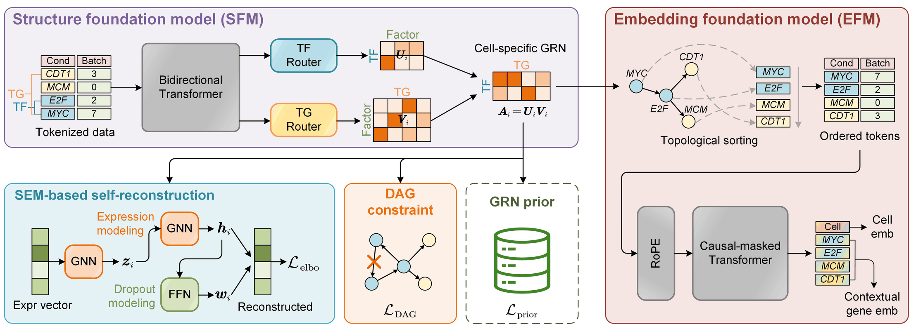

<p align="center">
  
</p>

<p align="center">
  <b>Building a causality-aware single-cell RNA-seq foundation model via context-specific causal regulation modeling</b><br>
  <i>Nature Biomedical Engineering</i>, in press
</p>

<p align="center">
  Kaichen Xu*, Yuxuan Shen*, Maocheng Zhu, Zhenke Duan, Jin Liu†, Hao Wu†, Xiaobo Sun†<br>
  <sub>* Equal contribution &nbsp;·&nbsp; † Corresponding authors</sub>
</p>

<p align="center">
  
  <a href="https://huggingface.co/kaichenxu/scCAFM"></a>
  <a href="https://huggingface.co/datasets/kaichenxu/scCAFM-data"></a>
  
  <a href="LICENSE"></a>
</p>

<p align="center">
  <a href="#quick-start">Quick start</a> ·
  <a href="#tutorials">Tutorials</a> ·
  <a href="#installation">Installation</a> ·
  <a href="#model">Model</a> ·
  <a href="#citation">Citation</a>
</p>

**scCAFM** is a single-cell **Causality-Aware Foundation Model** pretrained on 49.7 million human and mouse cells to infer cell-specific gene regulatory networks (csGRNs) and learn transferable, contextual gene and cell embeddings. Its **Structure Foundation Module (SFM)** models causal regulatory relationships in a mixture-of-experts-mediated latent factor space, enabling scalable csGRN inference. Its **Embedding Foundation Module (EFM)** uses the inferred cell-specific causal gene orderings to learn causality-aware representations.

<p align="center">
  
</p>

## Highlights

- **Cell-specific causal GRNs.** Infer directed transcription-factor-to-target relationships for individual cells to characterize heterogeneous regulatory programs and developmental dynamics.
- **Pooled GRNs.** Aggregate cell-specific networks to characterize the regulatory structure shared within a cell population.
- **Causality-aware gene and cell embeddings.** Learn contextual representations that encode the regulatory relationships and hierarchies of the inferred csGRNs.
- **Atlas-scale inference.** Perform causal discovery in a low-dimensional latent factor space to support csGRN inference at atlas scale.
- **Transfer to new datasets.** Apply pretrained scCAFM zero-shot or fine-tuned to human and mouse scRNA-seq data.

The inferred networks and learned embeddings support gene perturbation prediction, cell type annotation, batch correction, cancer drug response prediction, and prediction of perturbation-induced cell fate transitions.

## Quick start

scCAFM runs on Linux with a CUDA-capable NVIDIA GPU. With a CUDA-enabled [PyTorch](https://pytorch.org/get-started/locally/) already installed:

```bash
git clone https://github.com/Catchxu/scCAFM.git
cd scCAFM
pip install packaging psutil ninja
pip install flash-attn --no-build-isolation
pip install flash-attn-4
pip install .
hf download kaichenxu/scCAFM --local-dir assets
```

Infer one gene regulatory network per cell:

```python
import pandas as pd
import scanpy as sc
from sccafm import GRNInferencer, ScPreprocessor, load_vocab_json, resolve_model_assets

assets = resolve_model_assets("assets")
token_dict = load_vocab_json(assets.vocab)
mouse_tfs = pd.read_csv(assets.mouse_tfs)["TF"].astype(str).tolist()

adata = sc.read_h5ad("tutorial_data/cell_specific_grns/mPancreas.h5ad")  # raw counts
adata.obs["species"] = "mouse"

# Keep every transcription factor as a regulator and add 500 variable target genes.
adata = ScPreprocessor(
    log1p=False,
    n_top_genes=500,
    remove_ribo_genes=True,
    remove_hb_genes=True,
    token_dict=token_dict,
    preserve_gene_names=mouse_tfs,
    hvg_exclude_gene_names=mouse_tfs,
    hvg_exclude_preserved_genes=True,
)(adata)

inferencer = GRNInferencer.from_pretrained(
    "assets", device="cuda:0", attention_backend="fa4", max_length=2048
)

# Cell-specific GRNs are computed lazily, batch by batch.
cell_grns = inferencer.infer_cell_specific(adata, batch_size=8, score_threshold=0.1)
for cell_ids, scores in cell_grns:
    ...  # scores: (cells, TFs, target genes)

# For a homogeneous population, average the networks into one pooled GRN.
pooled_grn = inferencer.infer_pooled(adata, batch_size=8)
edges = pooled_grn.to_edge_table()  # columns: Gene1 (TF), Gene2 (target), score
```

The example reads the mouse-pancreas file from the [tutorial data](#tutorial-data). For your own data, provide raw counts in `adata.X`, gene symbols in `adata.var_names`, and `adata.obs["species"]` set to `"human"` or `"mouse"`. On GPUs without FlashAttention-4 support, pass `attention_backend="fa2"`.

## Tutorials

Each notebook runs end to end on the [tutorial data](#tutorial-data) and explains how to adapt the workflow to your own dataset.

| | Tutorial | Data | Modules |
|:---:|---|---|:---:|
|  | **[Pooled GRNs with ChIP-seq benchmarking](docs/chipseq_grn_recovery.ipynb)**<br>Infer pooled GRNs from homogeneous cell populations and compare them with ChIP-seq reference networks. | hESC, mESC | SFM |
|  | **[Cell-specific GRNs in heterogeneous tissue](docs/cell_specific_grns.ipynb)**<br>Generate one GRN per cell and evaluate how well the networks recover annotated cell populations. | Mouse pancreas | SFM |
|  | **[Pooled GRNs with Perturb-seq validation](docs/perturbseq_edge_validation.ipynb)**<br>Infer a pooled GRN from control cells and validate the top-ranked edges with Perturb-seq measurements. | K562 | SFM |
|  | **[Cell type annotation with supervised fine-tuning](docs/cell_type_annotation.ipynb)**<br>Fine-tune EFM cell embeddings, fully or partially, and annotate held-out cells. | PBMC | SFM + EFM |
|  | **[Gene perturbation prediction](docs/gene_perturbation_prediction.ipynb)**<br>Predict responses to held-out single- and two-gene perturbations from EFM gene embeddings. | Norman | SFM + EFM |

### Tutorial data

Download the [tutorial datasets](https://huggingface.co/datasets/kaichenxu/scCAFM-data) (about 1.5 GB) into `tutorial_data/`, the path used by the notebooks:

```bash
hf download kaichenxu/scCAFM-data --repo-type dataset --local-dir tutorial_data
```

### Tutorial environment

To run the notebooks with the pinned dependency versions, create a separate Python 3.12 environment from the repository root:

```bash
conda create -n sccafm-tutorial python=3.12
conda activate sccafm-tutorial
pip install torch==2.11.0 --index-url https://download.pytorch.org/whl/cu130
pip install hatchling==1.31.0 packaging psutil ninja
pip install ".[py312]" --no-build-isolation
```

This setup uses CUDA 13.0 and includes FA4, FA2, and the notebook dependencies. The gene perturbation tutorial also needs the graph dependencies: `pip install ".[perturbation]"`.

## Installation

scCAFM supports Python 3.10–3.14 on Linux and needs a CUDA-capable NVIDIA GPU supported by FlashAttention. GPU memory requirements depend on the number of genes and the inference batch size. The commands in [Quick start](#quick-start) cover the default setup; the sections below give the details.

<details>
<summary><b>FlashAttention backends (FA4 and FA2)</b></summary>

<br>

scCAFM uses **FlashAttention-4 (FA4)** by default (`attention_backend="fa4"`) on supported Blackwell GPUs, such as B200 and RTX 6000 Pro. **FlashAttention-2 (FA2)** is available as an alternative backend (`attention_backend="fa2"`). Install both packages when using FA4, because scCAFM also uses FA2's padding and rotary-embedding utilities. See the [FlashAttention documentation](https://github.com/Dao-AILab/flash-attention#flashattention-4-cutedsl) for hardware requirements.

```bash
pip install packaging psutil ninja
pip install flash-attn --no-build-isolation
pip install flash-attn-4
```

An installed `flash-attn` package is reused. Otherwise, pip installs it and may compile it from source, which requires a compatible CUDA toolkit. If you use only the FA2 backend, skip `flash-attn-4`.

</details>

<details>
<summary><b>Prebuilt FA2 wheels</b></summary>

<br>

To avoid compiling FA2 locally, choose a wheel from the community-maintained [flash-attention-prebuild-wheels](https://github.com/mjun0812/flash-attention-prebuild-wheels) project. Select version 2.8.3 or a newer 3.x release matching your Python, PyTorch, CUDA, and platform, then run:

```bash
pip install /path/to/downloaded.whl
```

In the tutorial environment, install the wheel before `pip install ".[py312]"`; the `py312` extra requires `flash-attn>=2.8.3`.

</details>

<details>
<summary><b>Verify the attention backend</b></summary>

<br>

```bash
python tests/test_FA4.py   # default FA4 backend
python tests/test_FA2.py   # FA2 backend
```

</details>

<details>
<summary><b>Model location</b></summary>

<br>

`hf download kaichenxu/scCAFM --local-dir assets` places the pretrained model and shared resources in `assets/` under the repository root, where the notebooks expect them. To keep them elsewhere, replace `assets` with another path and pass that path when loading the model.

</details>

## Model

<p align="center">
  
</p>

**SFM** tokenizes the genes of a cell, encodes them with a bidirectional Transformer, and routes transcription factors and target genes into a shared latent factor space; the product of the two factor matrices is the cell-specific GRN. It is trained with SEM-based self-reconstruction, a DAG constraint, and an OmniPath-derived GRN prior. The DAG constraint is evaluated in the latent factor space, which lowers its cost from cubic in the number of genes to cubic in the number of factors. **EFM** sorts the genes of each cell topologically along its inferred GRN and encodes the ordered tokens with a causal-masked Transformer, producing a cell embedding and contextual gene embeddings.

| | SFM | EFM |
|---|---|---|
| Output | Cell-specific GRNs | Cell and contextual gene embeddings |
| Backbone | 12-layer bidirectional Transformer | 12-layer causal-masked Transformer with rotary position embeddings |
| Width | 768 dimensions, 12 heads | 768 dimensions, 12 heads |
| Latent factors | 256, each gene routed to at most 32 | – |
| Parameters | 135.4 M | 149.0 M |

Both modules share a vocabulary of 20,275 gene tokens and are pretrained on 31.5 million human and 18.2 million mouse cells. Weights, tokenizer, and transcription-factor resources are on the [Hugging Face model page](https://huggingface.co/kaichenxu/scCAFM).

## Repository layout

| Path | Contents |
|---|---|
| `src/sccafm/` | Package: models, preprocessing, GRN inference, annotation, perturbation prediction, and training code |
| `docs/` | Tutorial notebooks and figures |
| `configs/` | Model and pretraining configurations |
| `data/` | Pretraining-data download and gene-embedding utilities ([guide](data/README.md)) |
| `scripts/` | Pretraining launch scripts |
| `tests/` | Attention-backend checks |
| `assets/`, `tutorial_data/` | Local download targets for the model and tutorial data (not tracked) |

## Citation

If scCAFM is useful in your research, please cite:

```bibtex
@article{xu2026sccafm,
  title   = {Building a causality-aware single-cell RNA-seq foundation model via context-specific causal regulation modeling},
  author  = {Xu, Kaichen and Shen, Yuxuan and Zhu, Maocheng and Duan, Zhenke and Liu, Jin and Wu, Hao and Sun, Xiaobo},
  journal = {Nature Biomedical Engineering},
  year    = {2026},
  note    = {In press}
}
```

## License and support

scCAFM is released under the [GPL-3.0 license](LICENSE). Questions, bug reports, and feature requests are welcome through [GitHub Issues](https://github.com/Catchxu/scCAFM/issues).
